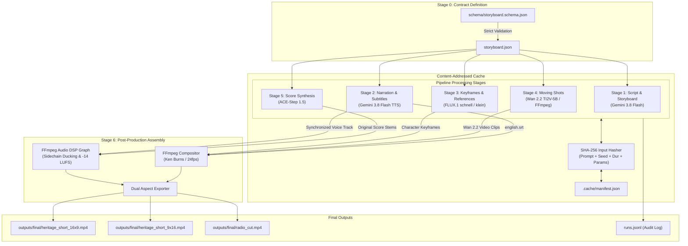
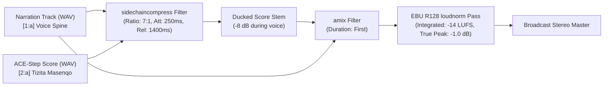

# ARCHITECTURE.md: Studio System Architecture & Pipeline Design

This document details the engineering architecture, stage contracts, content-addressable caching, failure handling, and signal processing workflows powering **The Heritage Short** multi-model AI film studio.

---

## 1. High-Level System Architecture

The studio is designed around a single immutable contract: `storyboard.json`. Every stage reads this schema-validated contract, processes its assigned responsibility independently, and produces cached, versioned artifacts into `outputs/`.



---

## 2. Core Architectural Principles

1. **Schema as Contract**: No stage operates on assumptions. `schema/storyboard.schema.json` enforces exact data types, duration bounds (60–90 seconds total, 2–15 seconds per shot), presence of Amharic narration, English subtitles, style blocks, and design intent reasons before any model execution starts.
2. **Shot-Level Isolation & Granular Caching**: Every shot is an independent unit of execution. Changing Shot 06 does not trigger regeneration of Shots 01–05 or Shots 07–10.
3. **Idempotency & Zero-Cost Re-Runs**: If the input hash matches `.cache/manifest.json` and the output exists on disk, the stage bypasses model invocation and logs `cached=True` in 0.01 seconds with $0.00 cost.
4. **Resilient Dual-Path Execution**: Every external API call (Gemini Flash, Cloudflare FLUX, Wan 2.2, ACE-Step) possesses a deterministic, zero-dependency local fallback. If network quotas or GPU queues fail, the pipeline still completes end-to-end.
5. **Separation of Secrets**: All API tokens (`GEMINI_API_KEY`, `CLOUDFLARE_API_TOKEN`) are loaded via environment variables; `.env` is ignored by `.gitignore`.

---

## 3. The Central Contract (`storyboard.json`)

The storyboard serves as the single source of truth across all 6 stages.

| Contract Block | Purpose | Consumed By |
| :--- | :--- | :--- |
| `style_block` | Fixed aesthetic description (35mm grain, lighting, palette, lens) appended to all prompts | `pipeline/keyframes.py` |
| `character_sheets` | Master character reference prompts (Young Girma, Elder Girma, Grandfather Assefa) | `pipeline/keyframes.py` |
| `shots[].visual_prompt` | Keyframe visual descriptions | `pipeline/keyframes.py` |
| `shots[].motion_prompt` | Video camera dynamics & subject motion descriptions | `pipeline/shots.py` |
| `shots[].narration` | Spoken Amharic line, voice style, and English subtitle text | `pipeline/narration.py` |
| `shots[].music_cue` | Mood, instrumentation, and ducking attenuation parameters | `pipeline/music.py`, `pipeline/assemble.py` |
| `shots[].reason` | Design rationale explaining narrative function | `DESIGN.md`, Audit |

---

## 4. Content-Addressable Caching Engine (`pipeline/cache.py`)

To eliminate wasteful GPU and API spending, caching is governed by cryptographic digests:

$$\text{CacheKey} = \text{SHA256}(\text{stage} + \text{shot\_id} + \text{model} + \text{JSON}(\text{inputs}))$$

Where `inputs` includes:
- Prompt text (visual and motion)
- Duration in seconds
- Character reference ID
- Audio text and voice style parameters
- Seed and resolution

### Invalidation Mechanics
- If a developer edits `shot["narration"]["amharic"]` in `storyboard.json`, only `narration_shot_XX.wav` and `english.srt` are marked stale and regenerated.
- If a user runs `python run_pipeline.py --shot shot_06`, the CLI selectively wipes cache entries for `shot_06` across stages, forcing an isolated live regeneration.

---

## 5. Audio DSP & Sidechain Ducking Architecture

A frequent failure mode in AI films is music masking narration. In `pipeline/assemble.py`, audio is mastered using a professional multi-stage DSP filtergraph:



### FFmpeg Filtergraph Specification:
```bash
[0:v]scale=1920:1080:force_original_aspect_ratio=decrease,pad=1920:1080:(ow-iw)/2:(oh-ih)/2[v0];
[2:a][1:a]sidechaincompress=threshold=0.025:ratio=7:attack=250:release=1400[ducked_score];
[ducked_score][1:a]amix=inputs=2:duration=first:dropout_transition=2[mixed_audio];
[mixed_audio]loudnorm=I=-14:TP=-1.0:LRA=10[final_audio]
```

---

## 6. Dual Aspect Ratio Safe Area Compositing

Both 16:9 and 9:16 deliverables are rendered from the same keyframes and motion clips using algorithmic cropping and safe area positioning:
- **16:9 Landscape (`1920x1080`)**: Preserves the complete horizontal cinema framing with bottom-centered subtitles (font size: 28pt, bottom margin: 45px).
- **9:16 Vertical (`1080x1920`)**: Centers the 16:9 source horizontally and extracts the middle 607px before scaling to 1080x1920 (`crop=607:1080:(1920-607)/2:0,scale=1080:1920`). Subtitles are elevated by 85px to avoid UI buttons on mobile platforms.

---

## 7. Audit Logging Architecture (`runs.jsonl`)

Every model invocation is atomically appended to `runs.jsonl` using a thread-safe mutex lock. Each line contains:
- `timestamp`: UTC ISO8601 timestamp
- `stage`: Stage identifier
- `shot_id`: Individual shot or "all"
- `model`: Model version (e.g., `gemini-3.8-flash-tts`, `flux.1-schnell`, `wan-2.2-ti2v-5b`, `ace-step-1.5`, `ffmpeg-7.0`)
- `parameters`: Exact parameters sent to model
- `seed`: Random seed for reproducibility
- `latency_seconds`: Precise measured elapsed time
- `cost_usd`: Measured or list-price dollar equivalent
- `cached`: Boolean flag indicating if cache hit occurred
- `status`: Execution status (`success`, `fallback`, `failed`)
- `notes`: Diagnostic notes
